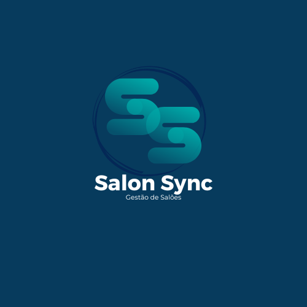

<p align="center"></p>

# Salon Sync

Aplicação web para gestão de salões e barbearias, com back-end em **Minimal API** e front-end em **Blazor WebAssembly**, sobre .NET 8.

> **Status:** projeto pessoal em desenvolvimento (versão 0.1.0), mantido como portfólio.

## Funcionalidades

- **Agendamento:** disponibilidade por profissional, duração do serviço, horário de trabalho e status do horário (livre, agendado, concluído e cancelado). Há agendamento manual e agendamento automático a partir de pacote.
- **Pacotes de serviços:** vigência, sessões restantes e registro de sessões utilizadas por cliente.
- **Cadastros:** clientes, profissionais e empresas.
- **Financeiro:** transações, centros de custo e comissões.
- **Licenças:** verificação e atualização da licença de cada empresa.
- **Página pública por empresa:** consulta de datas e horários disponíveis a partir do código da empresa.
- **Acesso por perfil:** `SuperAdmin`, `CompanyUser` e `EmployeeUser`, com ASP.NET Core Identity.

As regras de negócio do agendamento estão em [`docs/regras-de-negocio-agendamento.txt`](docs/regras-de-negocio-agendamento.txt) e o escopo inicial em [`docs/MVP.txt`](docs/MVP.txt).

## Stack

C#, .NET 8, ASP.NET Core Minimal API, Blazor WebAssembly, MudBlazor, Entity Framework Core, SQL Server, ASP.NET Core Identity e Swagger.

## Estrutura

| Projeto | Responsabilidade |
| --- | --- |
| `SalonSync.Api` | Minimal API: endpoints por área, handlers, serviços, migrations e acesso a dados |
| `SalonSync.Core` | Contratos compartilhados: DTOs, requests, responses, enums e handlers |
| `SalonSync.Web` | Front-end Blazor WebAssembly com MudBlazor |

Os endpoints ficam em `SalonSync.Api/Endpoints`, agrupados por área: agendamentos, pacotes de clientes, configurações, cadastros, financeiro, identidade, licenças, pacotes e serviços.

## Executar localmente

Pré-requisitos: .NET 8 SDK e um SQL Server acessível.

Configure os segredos fora do repositório:

```powershell
cd SalonSync.Api
dotnet user-secrets set "ConnectionStrings:DefaultConnection" "Server=...;Database=...;User Id=...;Password=...;TrustServerCertificate=True"
dotnet user-secrets set "SuperAdminPass" "UseUmaSenhaForteAqui"
dotnet user-secrets set "Smtp:UserName" "..."
dotnet user-secrets set "Smtp:Password" "..."
```

O usuário `SuperAdmin` e os perfis de acesso são criados na inicialização da API. As configurações de SMTP (`Smtp:Host`, padrão `smtp-relay.brevo.com`) são necessárias para o envio de e-mails.

Aplique as migrations e inicie a API e o front-end, cada um em um terminal:

```powershell
dotnet ef database update --project SalonSync.Api
dotnet run --project SalonSync.Api
dotnet run --project SalonSync.Web
```

Por padrão, a API usa `http://localhost:5032` e o front-end `http://localhost:5154`. A documentação Swagger fica disponível na API em ambiente de desenvolvimento.

## Próximos passos

Veja [`docs/TODO.md`](docs/TODO.md).
